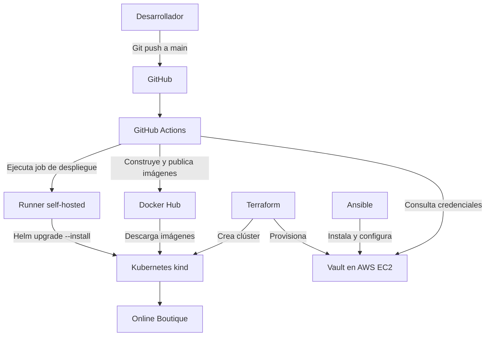

# Online Boutique — Proyecto Integrador DevOps

Implementación de una solución DevOps para automatizar la infraestructura, construcción de imágenes, despliegue de microservicios y gestión de secretos de Online Boutique mediante Terraform, GitHub Actions, Docker, Kubernetes, Helm, Ansible y HashiCorp Vault.

## 1. Descripción del proyecto

Online Boutique es una aplicación de comercio electrónico basada en microservicios. Incluye funciones como catálogo de productos, carrito de compras, pagos, recomendaciones, envíos y procesamiento de pedidos.

Este proyecto se desarrolló como parte de la materia **Proyecto Integrador de la Metodología DevOps**, con el objetivo de aplicar herramientas de automatización, integración continua, entrega continua e infraestructura como código.

## 2. Problema identificado

En una aplicación formada por varios microservicios, administrar y actualizar cada componente manualmente puede consumir mucho tiempo y provocar errores.

Entre los principales problemas identificados se encuentran:

- La necesidad de construir y actualizar múltiples servicios.
- Los errores que pueden ocurrir durante despliegues manuales.
- La dificultad de mantener configuraciones consistentes.
- El riesgo de exponer credenciales en archivos o repositorios.
- La necesidad de repetir procesos de instalación y configuración.

## 3. Propuesta DevOps

La propuesta consiste en automatizar las principales actividades de infraestructura y despliegue mediante herramientas DevOps.

Se plantearon las siguientes soluciones:

- **Terraform:** definir y crear infraestructura mediante código.
- **GitHub Actions:** automatizar la construcción y publicación de imágenes Docker.
- **Docker Hub:** almacenar las imágenes de los microservicios.
- **Kubernetes kind:** ejecutar la aplicación en un clúster local.
- **Helm:** administrar los despliegues de Kubernetes.
- **Ansible:** automatizar la instalación y configuración de Vault.
- **HashiCorp Vault:** almacenar credenciales y controlar el acceso mediante políticas.

## 4. Arquitectura de la solución

El proyecto combina recursos locales y servicios en la nube.



El proceso comienza cuando se envían cambios a la rama `main` del repositorio. GitHub Actions ejecuta el pipeline, obtiene las credenciales de Docker Hub desde Vault y construye las imágenes.

Después, el job de despliegue utiliza un runner self-hosted para ejecutar Helm sobre el clúster Kubernetes local.

## 5. Estructura principal del repositorio

| Ruta | Descripción |
|---|---|
| `.github/workflows/ci-build.yml` | Pipeline de construcción, publicación y despliegue |
| `.github/workflows/vault-demo.yml` | Prueba manual de integración con Vault |
| `terraform_local/main.tf` | Creación del clúster kind |
| `terraform_aws/main.tf` | Infraestructura AWS para Vault |
| `ansible-lab/instalar-vault.yml` | Instalación y configuración de Vault |
| `ansible-lab/templates/vault.hcl.j2` | Plantilla de configuración de Vault |
| `ansible-lab/politicas/ci-readonly.hcl` | Política de lectura para el pipeline |
| `helm-chart-custom/values.yaml` | Configuración de los servicios |
| `helm-chart-custom/templates/` | Plantillas de Kubernetes |

## 6. Infraestructura con Terraform

### 6.1 Clúster local

Se utilizó Terraform con el proveedor `tehcyx/kind`, versión `0.7.0`, para definir el clúster local.

El archivo `terraform_local/main.tf` crea un clúster llamado `online-boutique` y espera hasta que esté listo.

Esto permite reproducir la infraestructura local mediante código, en lugar de crear el clúster manualmente.

### 6.2 Infraestructura AWS

El archivo `terraform_aws/main.tf` define los siguientes recursos:

- Proveedor AWS en la región `us-east-1`.
- Imagen Ubuntu Server 24.04.
- Llave pública SSH para acceder al servidor.
- Grupo de seguridad con los puertos 22 y 8200.
- Instancia EC2 de tipo `t3.micro`.
- Output `ip_publica` para conocer la dirección de la instancia.

La instancia EC2 se utiliza para ejecutar HashiCorp Vault.

**Nota de seguridad:** esta configuración corresponde a un laboratorio. Los puertos están abiertos a `0.0.0.0/0` y el listener de Vault utiliza HTTP. Para producción se necesitaría restringir el acceso y habilitar TLS.

## 7. Automatización con Ansible y Vault

El playbook `ansible-lab/instalar-vault.yml` automatiza la preparación del servidor.

Sus actividades principales son:

1. Descargar la llave del repositorio de HashiCorp.
2. Agregar el repositorio de paquetes.
3. Instalar Vault.
4. Crear la carpeta de almacenamiento con permisos.
5. Generar `/etc/vault.d/vault.hcl` mediante una plantilla.
6. Iniciar y habilitar el servicio Vault.

El playbook también utiliza un handler que reinicia Vault cuando cambia su configuración.

### 7.1 Administración de secretos

Vault almacena las credenciales utilizadas por GitHub Actions para autenticarse en Docker Hub.

El workflow consulta la ruta:

`secret/data/online-boutique/dockerhub`

La política `ci-readonly.hcl` permite únicamente la lectura de secretos dentro de la ruta autorizada:

```hcl
path "secret/data/online-boutique/*" {
  capabilities = ["read"]
}
```

De esta manera, el pipeline no necesita guardar directamente las credenciales de Docker Hub en el código.

La variable `VAULT_ADDR` indica la dirección del servidor, mientras que el secreto de GitHub `VAULT_TOKEN` permite autenticarse ante Vault.

**Importante:** no publicar tokens reales, llaves de desbloqueo de Vault, credenciales de AWS ni contraseñas en el repositorio.

## 8. Pipeline CI/CD con GitHub Actions

El workflow principal se encuentra en `.github/workflows/ci-build.yml`.

Se ejecuta automáticamente cuando se realiza un `push` a la rama `main`.

### 8.1 Integración continua

El job `build-and-push` se ejecuta en `ubuntu-latest`.

Sus pasos principales son:

1. Descargar el código del repositorio.
2. Solicitar a Vault las credenciales de Docker Hub.
3. Iniciar sesión en Docker Hub.
4. Construir y publicar las imágenes Docker.

La matriz incluye 12 servicios:

- frontend
- adservice
- cartservice
- checkoutservice
- currencyservice
- emailservice
- loadgenerator
- paymentservice
- productcatalogservice
- recommendationservice
- shippingservice
- shoppingassistantservice

Las imágenes se publican con la etiqueta `latest` en la cuenta de Docker Hub configurada.

### 8.2 Despliegue continuo

El job `deploy` depende de `build-and-push`, por lo que comienza después de que termina correctamente la construcción de las imágenes.

Este job utiliza un runner `self-hosted`, que tiene acceso al entorno local de Kubernetes.

El despliegue se realiza mediante Helm, utilizando el Chart `helm-chart-custom`.

### 8.3 Prueba de Vault

El workflow `.github/workflows/vault-demo.yml` se ejecuta manualmente mediante `workflow_dispatch`.

Su propósito es comprobar que GitHub Actions puede consultar Vault y utilizar las credenciales obtenidas para iniciar sesión en Docker Hub.

## 9. Despliegue con Helm y Kubernetes

El Helm Chart personalizado se encuentra en `helm-chart-custom`.

El archivo `values.yaml` establece:

- Repositorio de imágenes: `huevarios`.
- Etiqueta de imágenes: `latest`.
- Puertos y variables de entorno.
- Configuración de Redis.

La plantilla `deployments.yaml` recorre los servicios definidos en `values.yaml` y genera un Deployment para cada uno.

La plantilla `services.yaml` crea Services de tipo `ClusterIP`, que permiten la comunicación interna.

La plantilla `redis.yaml` crea el Deployment y el Service de Redis para el carrito de compras.

**Alcance actual:** el pipeline construye 12 imágenes Docker. El Helm Chart personalizado configura directamente 10 microservicios y Redis. Los servicios `loadgenerator` y `shoppingassistantservice` no tienen Deployments propios definidos en este Chart.

## 10. Cómo reproducir el proyecto

### Requisitos

Se necesita un entorno con:

- Git y acceso al repositorio.
- Terraform.
- Docker y kind.
- Kubernetes CLI (`kubectl`).
- Helm.
- Ansible.
- Acceso autorizado a AWS.
- HashiCorp Vault CLI.
- Runner self-hosted configurado para GitHub Actions.
- Permisos y credenciales necesarios.

### Paso 1. Preparar AWS

Iniciar el entorno AWS Academy, si se utiliza, y configurar credenciales válidas de AWS.

Desde el directorio correspondiente a la infraestructura AWS:

```bash
terraform init
terraform plan
terraform apply
terraform output ip_publica
```

La dirección IP obtenida se utiliza para acceder al servidor.

### Paso 2. Configurar Vault

Actualizar el inventario de Ansible con la IP y los datos de conexión correspondientes.

Ejecutar el playbook:

```bash
ansible-playbook -i inventario-aws.ini instalar-vault.yml
```

Inicializar Vault únicamente si es una instalación nueva. En instalaciones ya inicializadas, desbloquearlo con las llaves autorizadas.

Configurar la política de lectura y las credenciales necesarias sin publicar valores sensibles.

### Paso 3. Crear el clúster local

Desde `terraform_local`:

```bash
terraform init
terraform plan
terraform apply
```

Verificar el clúster:

```bash
kubectl get nodes
```

### Paso 4. Preparar GitHub Actions

Configurar en GitHub:

- Variable `VAULT_ADDR` con la dirección accesible de Vault.
- Secreto `VAULT_TOKEN` con un token autorizado para leer las credenciales.
- Runner self-hosted activo y conectado al repositorio.

### Paso 5. Ejecutar el pipeline

Enviar cambios autorizados a la rama `main` para activar el workflow `ci-build.yml`.

Verificar en GitHub Actions la construcción y publicación de imágenes y la ejecución del job de despliegue.

### Paso 6. Comprobar Kubernetes

Verificar los recursos desplegados:

```bash
kubectl get deployments
kubectl get pods
kubectl get services
```

Para acceder al frontend localmente, cuando el Service esté disponible:

```bash
kubectl port-forward service/frontend 8080:80
```

Después, abrir `http://localhost:8080` en el navegador.

## 11. Resultados

Durante el proyecto se implementaron los siguientes componentes:

- Infraestructura local definida mediante Terraform.
- Infraestructura AWS definida mediante Terraform.
- Automatización de la instalación de Vault con Ansible.
- Políticas de acceso a secretos.
- Workflow para probar la lectura de credenciales desde Vault.
- Pipeline para construir y publicar 12 imágenes Docker.
- Configuración de despliegue con Helm en Kubernetes.
- Uso de un runner self-hosted para acceder al clúster local.

Las pruebas realizadas durante el desarrollo incluyeron autenticación con Docker Hub mediante Vault, construcción de imágenes y despliegues de la aplicación.

Los tiempos exactos de ejecución y otras métricas cuantitativas deben incorporarse a partir de las evidencias de GitHub Actions y las pruebas registradas. No se presentan cifras de mejora que no hayan sido medidas.

## 12. Retos y lecciones aprendidas

### Cambios de dirección IP en AWS

Al reiniciar o recrear la instancia EC2, la dirección IP pública puede cambiar. Esto requiere actualizar la configuración de acceso y la variable `VAULT_ADDR`.

### Desbloqueo de Vault

Vault puede quedar sellado después de reiniciar el servicio. Para volver a utilizar los secretos es necesario desbloquearlo mediante el procedimiento autorizado.

### Credenciales temporales de AWS

En AWS Academy, las credenciales pueden caducar, por lo que es necesario renovarlas antes de ejecutar Terraform.

### Runner self-hosted

El despliegue necesita un runner con acceso al clúster local. Esto permite comprender la diferencia entre ejecutar la construcción en un runner de GitHub y desplegar desde el equipo local.

### Automatización e idempotencia

Terraform y Ansible permiten administrar recursos mediante configuraciones declarativas. El handler de Ansible evita reinicios innecesarios cuando la plantilla no cambia.

## 13. Conclusiones

El proyecto permitió integrar diferentes herramientas DevOps para automatizar actividades que normalmente requieren varios pasos manuales.

Terraform facilitó la definición de infraestructura, GitHub Actions automatizó la construcción de imágenes, Ansible permitió configurar Vault y Helm organizó el despliegue de la aplicación en Kubernetes.

También se aplicaron conceptos de seguridad mediante la administración centralizada de secretos y políticas de acceso.

Como mejoras futuras se consideran reforzar la seguridad de red y TLS, revisar la configuración de despliegue de todos los microservicios y medir los tiempos de ejecución para evaluar el impacto de la automatización.

## 14. Autor

**Gael Portilla Lopez**

Materia: Proyecto Integrador de la Metodología DevOps

Profesor: Ing. William Balán

Proyecto: Online Boutique — Fase IV
