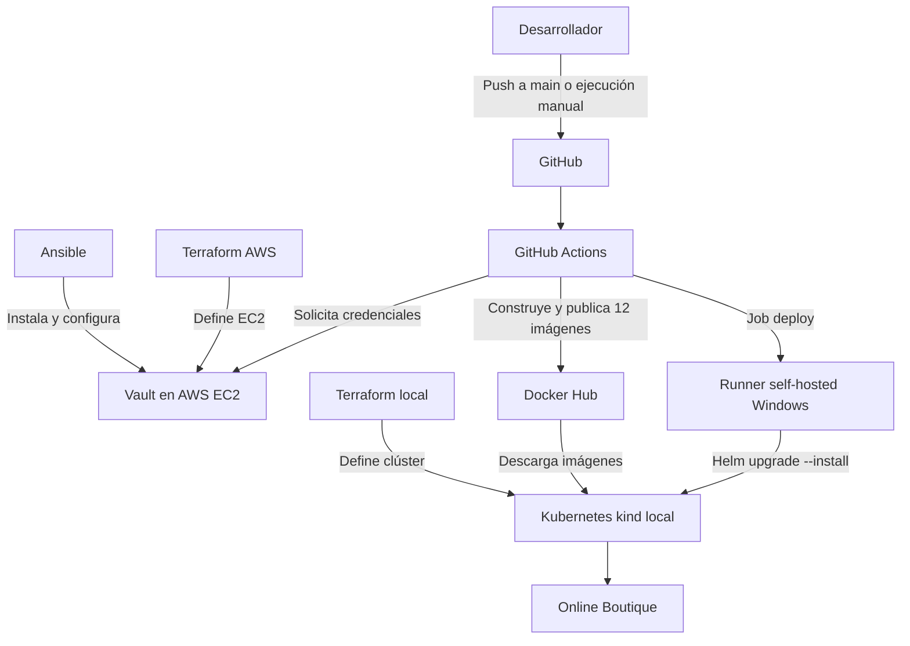

# Online Boutique — Proyecto Integrador DevOps

Implementación de DevOps para automatizar infraestructura, construcción de imágenes, despliegue de microservicios y administración de secretos con Terraform, GitHub Actions, Docker, Kubernetes, Helm, Ansible y HashiCorp Vault.

**Repositorio:** https://github.com/bobbycheeza/microservices-demo

## 1. Descripción del proyecto

Online Boutique es una aplicación de comercio electrónico basada en microservicios. Cuenta con catálogo de productos, carrito, pagos, recomendaciones, envíos y procesamiento de pedidos. Este proyecto aplica automatización DevOps en un clúster Kubernetes local y un servidor Vault en AWS EC2.

## 2. Problema identificado

En la propuesta comercial de la Fase I se identificó que actualizar manualmente varios microservicios puede provocar retrasos, errores de configuración y fallas de comunicación entre servicios. Por ejemplo, cambiar el servicio de pagos requiere comprobar que siga funcionando con el carrito y los demás componentes.

Los beneficios propuestos fueron: **actualizaciones más rápidas, menos errores, mayor confiabilidad, administración más sencilla y preparación para atender más usuarios**. El proyecto busca avanzar hacia estos beneficios automatizando infraestructura, construcción de imágenes, despliegues y credenciales. No se afirma una mejora de disponibilidad o escalabilidad sin mediciones.

## 3. Propuesta DevOps y beneficios obtenidos

- **Terraform:** infraestructura local kind y servidor AWS definidos mediante código.
- **GitHub Actions:** construcción y publicación automática de imágenes.
- **Docker Hub:** almacenamiento de imágenes.
- **Kubernetes kind:** ejecución local de microservicios.
- **Helm:** despliegue organizado mediante un Chart personalizado.
- **Ansible:** instalación y configuración repetible de Vault.
- **Vault:** almacenamiento centralizado de credenciales con permisos limitados.
- **Runner self-hosted:** despliegue desde el equipo que tiene acceso al clúster local.

| Beneficio prometido en Fase I | Resultado comprobado |
|---|---|
| Actualizaciones más rápidas | Pipelines exitosos de 2 min 34 s, 2 min 31 s y 2 min 18 s; no existe una medición comparable del proceso manual |
| Menos trabajo manual | Construcción y publicación automática de 12 imágenes Docker |
| Administración consistente | Terraform recreó el clúster; Ansible terminó su segunda ejecución con `changed=0` |
| Gestión más segura de credenciales | Vault, política de lectura, rechazo HTTP 403 a escritura y reducción de 2 a 0 secretos de Docker Hub guardados directamente en GitHub |
| Aplicación confiable para pruebas | Despliegue exitoso y frontend accesible en `localhost:8080`; no se midió disponibilidad de producción |
| Preparación para más usuarios | Arquitectura de microservicios; no se realizaron pruebas de carga que cuantifiquen escalabilidad |

## 4. Arquitectura de la solución



GitHub Actions utiliza runners alojados por GitHub para construir imágenes y un runner self-hosted para desplegar en el clúster local. Las credenciales de Docker Hub se obtienen de Vault.

## 5. Estructura principal del repositorio

| Ruta | Función |
|---|---|
| `.github/workflows/ci-build.yml` | Construcción, publicación y despliegue |
| `.github/workflows/vault-demo.yml` | Prueba de integración con Vault |
| `terraform_local/main.tf` | Clúster kind |
| `terraform_aws/main.tf` | Recursos AWS |
| `ansible-lab/instalar-vault.yml` | Playbook de instalación |
| `ansible-lab/templates/vault.hcl.j2` | Plantilla de Vault |
| `ansible-lab/politicas/ci-readonly.hcl` | Política de lectura |
| `helm-chart-custom/values.yaml` | Valores del Chart |
| `helm-chart-custom/templates/` | Recursos Kubernetes |
| `src/` | Código de microservicios |

## 6. Infraestructura con Terraform

### 6.1 Clúster local

En `terraform_local/main.tf` se utiliza el proveedor `tehcyx/kind` versión `0.7.0` para definir el clúster `online-boutique`. En la Fase II se comprobó que podía eliminarse y recrearse con Terraform; el nodo volvió a aparecer en estado `Ready`.

### 6.2 AWS EC2

`terraform_aws/main.tf` define infraestructura en `us-east-1`: Ubuntu Server 24.04, instancia `t3.micro`, llave SSH, reglas de acceso para los puertos 22 y 8200 y un output llamado `ip_publica`.

El recurso `aws_instance` y el output `ip_publica` del archivo real `terraform_aws/main.tf` son:

```hcl
resource "aws_instance" "vault" {
  ami                    = data.aws_ami.ubuntu.id
  instance_type          = "t3.micro"
  key_name               = aws_key_pair.llave.key_name
  vpc_security_group_ids = [aws_security_group.vault.id]

  tags = {
    Name = "fase3-vault"
  }
}

output "ip_publica" {
  value = aws_instance.vault.public_ip
}
```

La AMI se obtiene de la consulta `data.aws_ami.ubuntu`; la llave SSH se referencia mediante `aws_key_pair.llave` y el grupo de seguridad mediante `aws_security_group.vault`. El output muestra la IP pública de la instancia para conectarse al servidor.

**Nota de seguridad:** esta es una configuración de laboratorio. El acceso HTTP a Vault y las reglas abiertas a `0.0.0.0/0` no son apropiados para producción. Sería necesario restringir la red y configurar TLS.

## 7. Automatización con Ansible y Vault

El playbook `ansible-lab/instalar-vault.yml` agrega el repositorio de HashiCorp, instala Vault, prepara el almacenamiento, genera `/etc/vault.d/vault.hcl`, habilita el servicio y utiliza un handler para reiniciarlo cuando cambia la configuración.

En la Fase III, una segunda ejecución del playbook terminó con **`changed=0`**. También se comprobó el handler modificando temporalmente la configuración y restaurándola después.

### 7.1 Secretos y política de acceso

Las credenciales de Docker Hub se consultan desde `secret/data/online-boutique/dockerhub`. La política de CI permite lectura, no escritura:

```hcl
path "secret/data/online-boutique/*" {
  capabilities = ["read"]
}
```

La prueba de escritura con el token de CI recibió **HTTP 403**. Después de integrar Vault se retiraron de GitHub los secretos `DOCKERHUB_USERNAME` y `DOCKERHUB_TOKEN`: pasaron de **2 a 0**. GitHub conserva `VAULT_TOKEN` para autenticar el pipeline y la variable `VAULT_ADDR` para localizar el servidor.

**Nunca publicar tokens, contraseñas, llaves de desellado, credenciales AWS ni archivos de estado de Terraform.**

## 8. Pipeline CI/CD con GitHub Actions

El workflow `.github/workflows/ci-build.yml` se ejecuta al enviar cambios a `main` y también permite ejecución manual con `workflow_dispatch`.

### 8.1 Construcción y publicación

La matriz de `build-and-push` incluye 12 servicios: `frontend`, `adservice`, `cartservice`, `checkoutservice`, `currencyservice`, `emailservice`, `loadgenerator`, `paymentservice`, `productcatalogservice`, `recommendationservice`, `shippingservice` y `shoppingassistantservice`. Para `cartservice` se usa el contexto `./src/cartservice/src`.

Fragmento del workflow que obtiene credenciales desde Vault:

```yaml
- name: Pedir credenciales de Docker Hub a Vault
  uses: hashicorp/vault-action@v4
  with:
    url: ${{ vars.VAULT_ADDR }}
    token: ${{ secrets.VAULT_TOKEN }}
    secrets: |
      secret/data/online-boutique/dockerhub username | DOCKERHUB_USERNAME ;
      secret/data/online-boutique/dockerhub token | DOCKERHUB_TOKEN
```

Después se utilizan `docker/login-action@v4` y `docker/build-push-action@v6` para publicar imágenes con la etiqueta `latest`.

### 8.2 Despliegue con Helm

El job `deploy` espera a que termine correctamente la construcción y se ejecuta en el runner `self-hosted`.

Comando utilizado en el workflow:

```powershell
helm upgrade --install online-boutique-custom ./helm-chart-custom `
  --set imageRepository=${{ env.DOCKERHUB_USERNAME }} `
  --set imageTag=latest
```

### 8.3 Prueba de Vault

El workflow `.github/workflows/vault-demo.yml` permite probar manualmente la lectura de credenciales. En la Fase III se comprobó que el inicio de sesión en Docker Hub devolvió `Login Succeeded`.

## 9. Despliegue con Helm y Kubernetes

El Chart `helm-chart-custom` genera Deployments y Services `ClusterIP` para los servicios definidos y recursos de Redis para el carrito.

**Alcance real:** el pipeline construye 12 imágenes, pero el Chart personalizado despliega **10 microservicios y Redis**. `loadgenerator` y `shoppingassistantservice` no tienen Deployments propios en este Chart.

El README anterior mencionaba `huevarios` como repositorio por defecto en `values.yaml`. El pipeline actual sobrescribe `imageRepository` con el usuario recuperado de Vault (`bobbycheeza`). También debe revisarse el valor por defecto del archivo `helm-chart-custom/values.yaml` para evitar referencias antiguas.

## 10. Cómo reproducir el proyecto

Los ejemplos de Windows utilizan **PowerShell**. Para Ansible se requiere un entorno Linux o WSL con Ansible instalado. También se necesitan Docker Desktop, Terraform, `kubectl`, Helm, Git, Vault CLI y acceso autorizado a AWS.

### Paso 1. Repositorio

```powershell
git clone https://github.com/bobbycheeza/microservices-demo.git
cd microservices-demo
```

Ruta utilizada durante el desarrollo:

```powershell
cd "C:\Users\gaelp\Desktop\Word\Octavo Semestre\Proyecto de DevOps\microservices-demo"
```

### Paso 2. AWS con Terraform

Desde la raíz del repositorio:

```powershell
cd terraform_aws
terraform init
terraform plan
terraform apply
terraform output ip_publica
```

**Cuando la EC2 ya existe y solo se necesita actualizar el estado de Terraform**, utilizar:

```powershell
terraform apply -refresh-only
terraform output ip_publica
```

`-refresh-only` no crea ni modifica la instancia; únicamente actualiza el estado y sus outputs. Revisar el plan antes de confirmar.

### Paso 3. Ansible

Desde la raíz del repositorio, en Linux/WSL, actualizar la IP del inventario y ejecutar:

```bash
cd ansible-lab
ansible-playbook -i inventario-aws.ini instalar-vault.yml
```

### Paso 4. VAULT_ADDR y desellado

En PowerShell, sustituir el marcador por la IP actual de EC2:

```powershell
$env:VAULT_ADDR = "http://<IP_PUBLICA_EC2>:8200"
vault status
vault operator unseal
vault operator unseal
vault status
```

En Linux/WSL se utiliza:

```bash
export VAULT_ADDR="http://<IP_PUBLICA_EC2>:8200"
vault status
```

Cada ejecución de `vault operator unseal` solicita una llave diferente. Introducirlas únicamente en la terminal autorizada, nunca como argumentos visibles, en capturas ni en el README. El servidor ya inicializado **no debe inicializarse de nuevo**. Confirmar que `Sealed` sea `false`.

### Paso 5. Clúster local

Con Docker Desktop iniciado, desde la raíz del repositorio:

```powershell
cd terraform_local
terraform init
terraform plan
terraform apply
kubectl --context kind-online-boutique get nodes
```

El nodo debe aparecer como `Ready`. Si el clúster ya existe, revisar el plan antes de aplicar cambios.

### Paso 6. Runner self-hosted

Abrir otra ventana de PowerShell:

```powershell
cd C:\actions-runner
.\run.cmd
```

Esperar `Listening for Jobs` y mantener la ventana abierta durante el despliegue.

### Paso 7. GitHub Actions

En **Settings → Secrets and variables → Actions** del repositorio, comprobar:

- Variable `VAULT_ADDR`: dirección actual de Vault.
- Secreto `VAULT_TOKEN`: token vigente con permisos `ci-readonly`.
- Runner self-hosted: conectado y disponible.

No agregar las credenciales de Docker Hub directamente como secretos de GitHub.

### Paso 8. Pipeline

En **Actions → CI/CD - Build, Push and Deploy**, ejecutar **Run workflow** o enviar un cambio autorizado a `main`. Verificar que los 12 jobs de construcción y el job de despliegue terminen correctamente.

### Paso 9. Kubernetes y frontend

```powershell
kubectl --context kind-online-boutique get deployments
kubectl --context kind-online-boutique get pods
kubectl --context kind-online-boutique get services
kubectl --context kind-online-boutique port-forward svc/frontend 8080:80
```

Abrir `http://localhost:8080`. **El port-forward al puerto 80 del Service `frontend` se comprobó funcionando con el Chart personalizado.** Mantener abierta la terminal mientras se utiliza la tienda.

## 11. Resultados

| Indicador | Resultado |
|---|---|
| Pipeline de Fase III, corrida 1 | **2 min 34 s** |
| Pipeline de Fase III, corrida 2 | **2 min 31 s** |
| Pipeline posterior, Fase IV | **2 min 18 s** (ejecución exitosa #4) |
| Imágenes Docker construidas y publicadas | **12** |
| Segunda ejecución de Ansible | **`changed=0`** |
| Intento de escritura con token `ci-readonly` | **HTTP 403** |
| Secretos de Docker Hub almacenados directamente en GitHub | **De 2 a 0** |
| Despliegue con Helm | **Exitoso** |
| Pods comprobados recientemente | **11 en estado `Running`** |
| Acceso al frontend | **Exitoso en `http://localhost:8080`** |

**Tiempo de arranque desde cero:** no se registró una medición completa y verificable, por lo que no se inventa una cifra. Se propone medir desde la preparación de la infraestructura hasta que el frontend responda.

Los tiempos de GitHub Actions no son una comparación controlada frente a un proceso manual. Tampoco se midieron porcentajes de reducción de errores, disponibilidad o escalabilidad.

## 12. Retos reales y soluciones

### Cambio de IP en AWS

La IP pública de EC2 cambió y la configuración dejó de apuntar al servidor correcto. Se actualizó la información con Terraform, el inventario de Ansible y `VAULT_ADDR`.

### Vault sellado

Vault quedó sellado tras reinicios. Se utilizaron las llaves autorizadas con `vault operator unseal` y se confirmó que volvió a estar disponible, sin reinicializarlo.

### Docker Desktop apagado

Terraform y Kubernetes no podían consultar el clúster porque kind depende de Docker. Se inició Docker Desktop, se verificó su funcionamiento y se repitieron los comandos.

### Cambio de cuenta de GitHub

La cuenta anterior dejó de estar disponible. Se publicó el repositorio en `bobbycheeza/microservices-demo`, se actualizó el remoto y se volvió a registrar el runner self-hosted. El pipeline terminó correctamente después de la recuperación.

### Credenciales de Docker Hub

Las credenciales anteriores dejaron de funcionar. Se generó un nuevo token, se actualizó Vault y se comprobó que GitHub Actions podía volver a autenticarse sin guardar el token de Docker Hub en GitHub.

### Despliegue local

El job `deploy` necesitaba que el runner y el clúster local estuvieran activos. Tras iniciar los componentes, se verificaron los pods y el acceso a la tienda mediante `kubectl port-forward svc/frontend 8080:80`.

## 13. Conclusiones

El proyecto integró infraestructura como código, automatización de configuración, gestión de secretos, construcción de imágenes y despliegue en Kubernetes. Se comprobaron 12 imágenes publicadas, ejecuciones de pipeline entre 2 min 18 s y 2 min 34 s, idempotencia de Ansible, rechazo de escritura con HTTP 403 y la eliminación de dos secretos de Docker Hub almacenados directamente en GitHub. La tienda también se abrió correctamente desde el navegador.

Estos resultados respaldan la automatización, la consistencia operativa y el control de credenciales propuestos en la Fase I. Como mejoras futuras quedan medir el arranque completo desde cero, comparar tiempos contra un procedimiento manual, habilitar TLS en Vault, restringir el acceso de red y realizar pruebas de carga.

## 14. Autor

**Gael Portilla Lopez**  
**Matrícula:** 3088695  
**Materia:** Proyecto Integrador de la Metodología DevOps  
**Profesor:** Ing. William Balán  
**Proyecto:** Online Boutique — Fase IV
